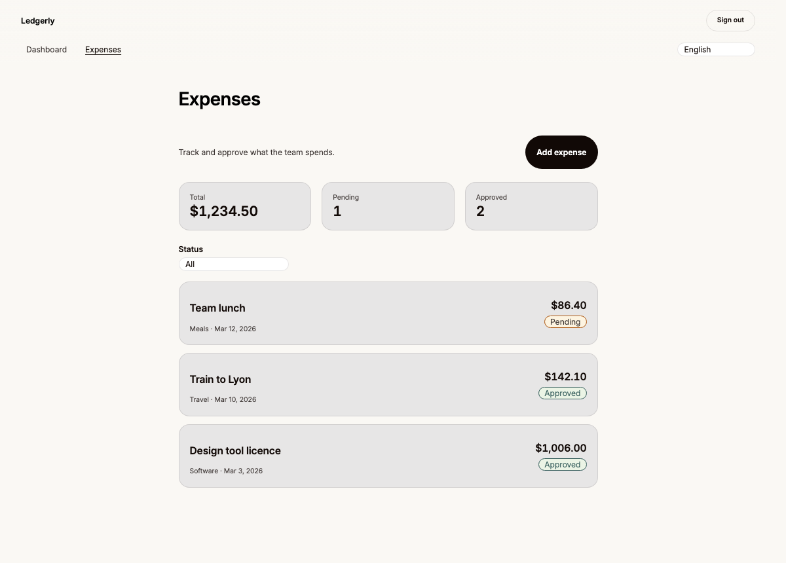
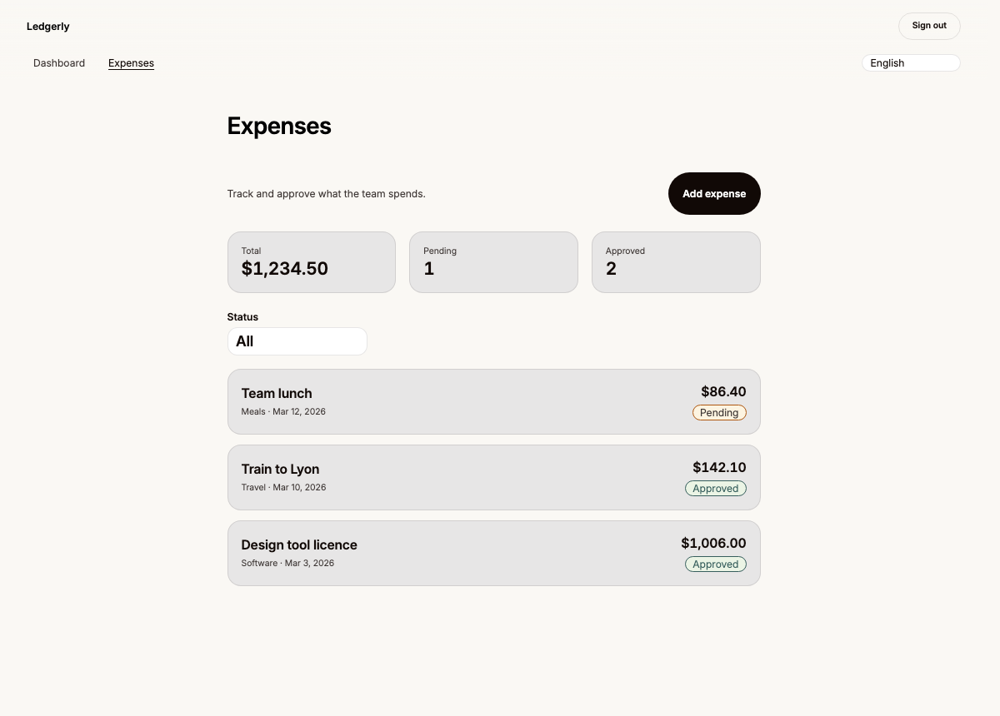
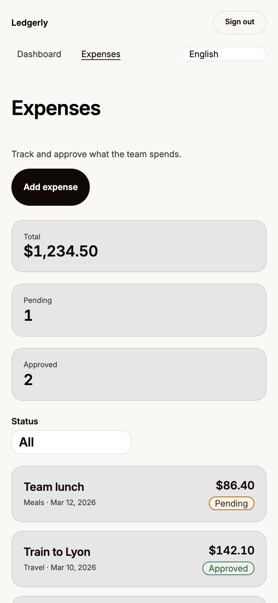
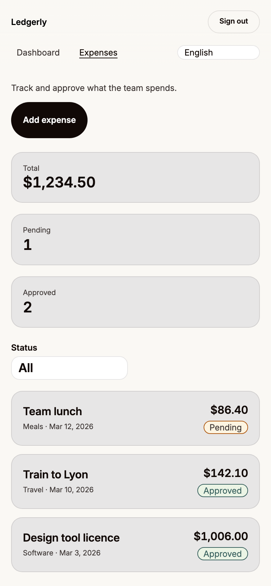
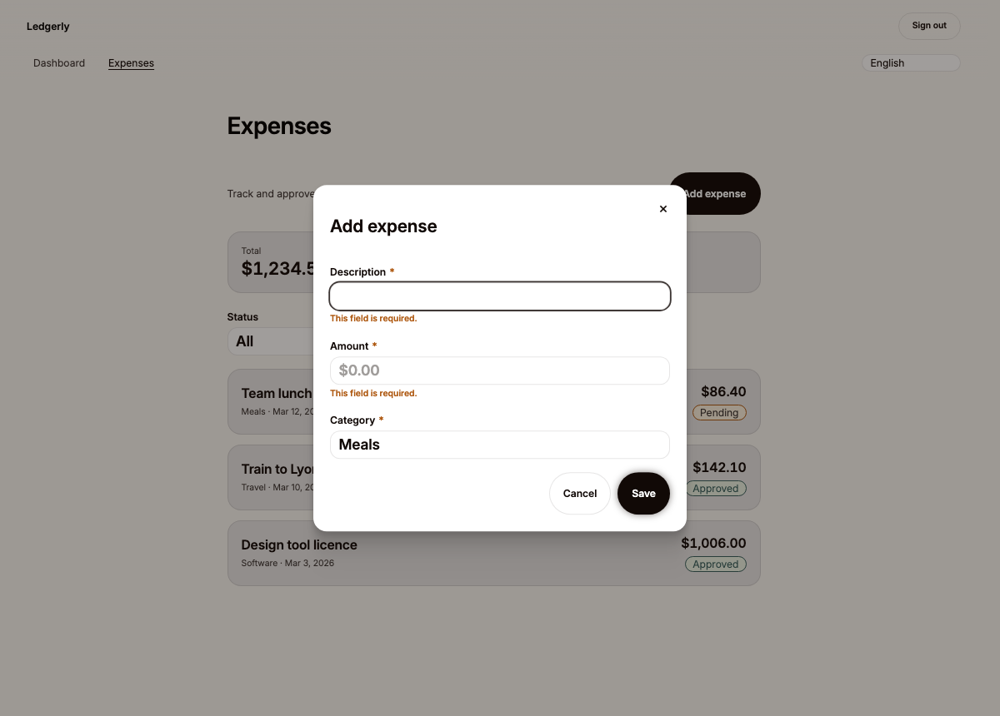
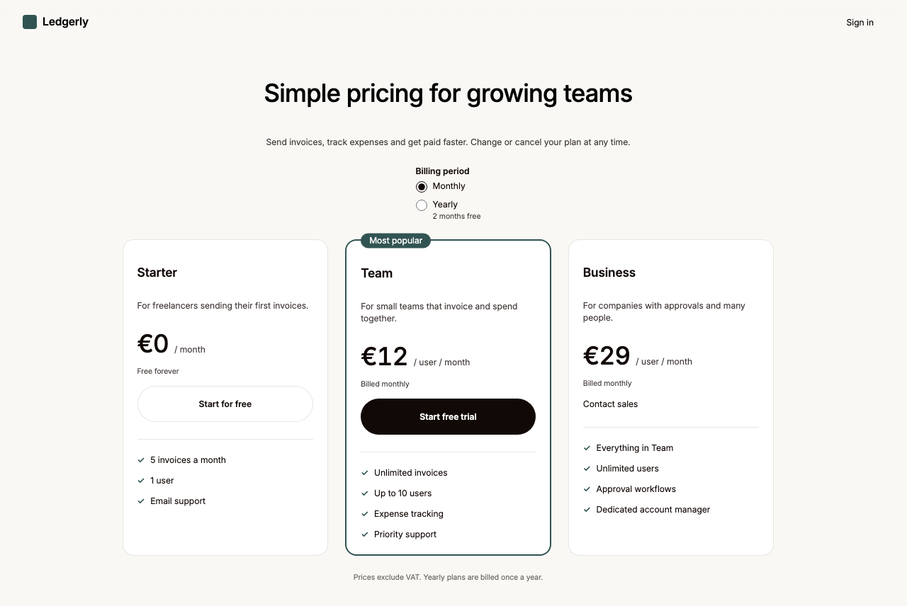
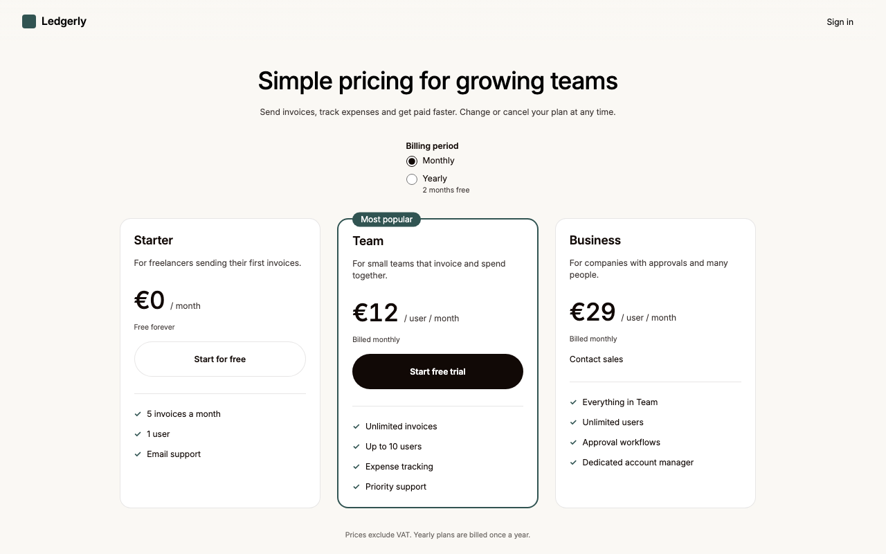
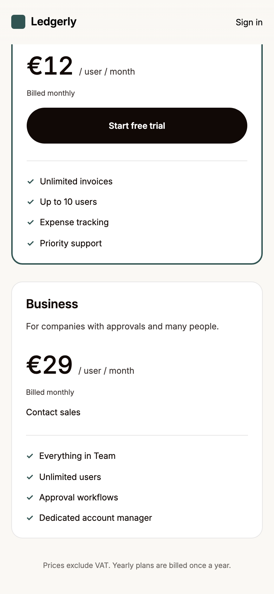

# Image-guided composition: demonstrations

Two complete runs of [compose-from-images](../../../docs/recipes/compose-from-images.md),
replayed by `pnpm adopt:check --scenario design` in an adopted copy (demo
and reference code removed; `scripts/lib/design/proof.mjs`):

| Task               | References                                                         | Built                                                                                 |
| ------------------ | ------------------------------------------------------------------ | ------------------------------------------------------------------------------------- |
| `expense-overview` | two hand-drawn wireframes: the page, and the add dialog after Save | the Expenses page: totals, a URL status filter, four list states, an add-expense form |
| `pricing`          | high-fidelity exports: desktop (scale 1), phone (scale 2), a crop  | the public Pricing page: three plans, billing period, calls to action                 |

## What is here

| Folder         | Contents                                                                                                                                                           |
| -------------- | ------------------------------------------------------------------------------------------------------------------------------------------------------------------ |
| `tasks/`       | each task's references and the plan written from them ([expense-overview](tasks/expense-overview/plan.json), [pricing](tasks/pricing/plan.json))                   |
| `files/`       | product code on top of the generated code (feature, components, pages, unit tests, e2e journeys), validated only inside the adopted copy                           |
| `copy/`        | the pages' copy in every locale, merged into the copy's locales                                                                                                    |
| `overlay.json` | generator commands, and the sha256 of every generated file the product code replaces or removes: a template change fails the scenario and names the file to review |
| `sources/`     | what the reference images were drawn from, for provenance only (re-rendering gives identical images)                                                               |
| `evidence/`    | renders from the demonstration run, below                                                                                                                          |

## Provenance and limits

The reference images are original work made for this repository (MIT, like
the rest): SVG wireframes drawn with a pencil filter and handwriting fonts,
and an HTML/CSS mock with its own look (Helvetica, a blue accent), each
rendered once in Chromium. They were made before any page code and are not
screenshots of the implementation. The same agent drew and then
interpreted them, so this proves the workflow and its tooling end to end,
not how well an agent reads unfamiliar images.

## Evidence index

From the runs on the agent's machine (Chromium 156, macOS); every CI run
of the `design` scenario uploads its own reports as the `design-evidence`
artifact. Every image is a screenshot at the scenario's requested viewport,
except one marked below: the "after" images were taken again from the
final code by `pnpm adopt:check --scenario design` once captures stopped
resizing the viewport (the first version grew it to the content height,
which changes `vh` units and height media queries). Mechanical results come from `pnpm design capture`; observations
are the agent's, recorded in each plan's `review`; no person has reviewed
the designs (`review.human`: not-reviewed).

Runs, in order, for both tasks:

1. `initial`: the first render. Mechanical failures exposed two wrong
   locators in the plans (a `status` region has no name from its text; the
   RadioGroup is a `radiogroup`, not a `group`) and three measurement rules
   in the tooling that failed correct layouts (block elements measured at
   full width, a badge sitting on its card's border, sideways relations
   between elements on different rows). The plans and the tooling were
   fixed, with tests; the pages were not touched.
2. `remeasured` (pricing: `remeasured-2`, after the third tooling fix):
   the same pages, all mechanical checks passing.
3. `round-1` (content and major layout) and `round-2` (spacing and
   details): the corrections below; `round-2` is the best verified run for
   both.

### Expenses (sketch)

| Round | Seen in the render vs the sketch                                                           | Change                                            |
| ----- | ------------------------------------------------------------------------------------------ | ------------------------------------------------- |
| 1     | rows loose: the "Meals · date" line ~30 px below the description (default heading margins) | details grouped under the description, no margins |
| 1     | phone: summary tiles wrap two plus one; the plan assumes one per row                       | one column on phones, three above                 |
| 2     | the status filter is a short pill without a chevron; the sketch shows a regular select     | default control size                              |
| 2     | the empty Amount field shows nothing; the sketch shows "$"                                 | formatted placeholder `$0.00`                     |

Before and after round 1, desktop:

Phone (assumed layout, no reference), 390×844 at scale 2: the first and
last of two screenshots of the layout's content area (scrolled 0 and
89 px), then the dialog after Save with empty fields (compared with the
second sketch):

Documented deviations: the add button sits on the intro row (the page
shell renders the heading), the sticky note's "hardcode the totals" is not
followed, error messages are the shared ones, dates follow the locale.
Remaining: more space under the heading than sketched (page shell), larger
type in the medium Select, rows ~8 px taller.

### Pricing (high-fidelity)

| Round | Seen in the render vs the export                                                             | Change                                                                       |
| ----- | -------------------------------------------------------------------------------------------- | ---------------------------------------------------------------------------- |
| 1     | the lead ~40 px under the heading, plan names far above their descriptions (heading margins) | no heading margins in the hero and cards                                     |
| 2     | after round 1 the plans start ~80 px higher than in the export                               | section spacing raised to the largest spacer; still ~55 px higher (accepted) |

Before round 1, from the first tooling version, which grew the 1280×800
viewport to 856 px (kept as recorded; not evidence of 1280×800):

After round 2 at 1280×800 (the last 12 px of content are in the run's
second screenshot), and on a phone at 390×844, scale 2: the first and last
of three screenshots (scrolled 0 and 794 of 1575 px; the one at 781 px is
in the run):

Documented deviations: radios instead of the segmented billing control,
theme colors and type instead of the blue accent and Helvetica, "Contact
sales" as an email link, a theme-colored brand mark. Remaining: the
export's 36–48 px rhythm exceeds the largest spacer (32 px), pill-shaped
buttons, a medium-weight heading.
